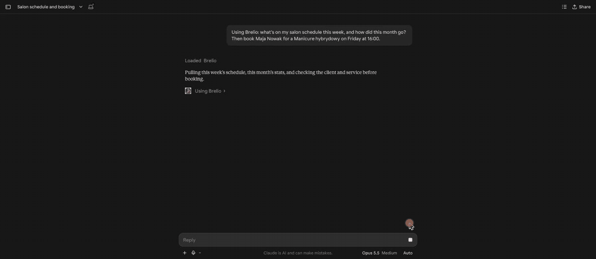

# Brelio MCP server

Brelio is salon management software for beauty salons: online booking, calendar, clients, services and payments.
Connect your AI assistant to your Brelio salon and ask it about your schedule and revenue, or have it book
appointments for you.



- Server URL: `https://brelio.eu/api/mcp` (Streamable HTTP, OAuth 2.1 with dynamic client registration)
- Website: [brelio.eu](https://brelio.eu) · [Privacy policy](https://brelio.eu/pl/privacy)

## Connect

**Claude (claude.ai, desktop and mobile):** Settings → Connectors → Add custom connector → paste
`https://brelio.eu/api/mcp`. Claude opens the Brelio sign-in page: sign in with your salon account and allow access.

**Claude Code:**

```bash
claude mcp add --transport http brelio https://brelio.eu/api/mcp
```

Clients without OAuth can use an API key from Brelio → Settings → MCP, sent as `Authorization: Bearer <key>`.

Then ask something like: *"What's on my schedule this week, and how did this month go?"* or *"Book Maja Nowak for a
manicure on Friday at 16:00."*

## Tools

| Tool | What it does |
| --- | --- |
| `get_appointments` | Appointments with client and service, filtered by dates and status |
| `get_clients` | Clients, searchable by name or phone |
| `list_services` | Services with duration and price |
| `get_stats` | Appointments, completed visits and revenue for today, the week, the month or the year |
| `create_appointment` | Books a confirmed appointment; a new client is added if needed |

## Source

The server is part of the Brelio web app (Next.js on Vercel, Supabase). This repository holds its MCP and OAuth
code as it runs in production:

| Path | What it is |
| --- | --- |
| `src/app/api/mcp/route.ts` | The MCP endpoint: Streamable HTTP, JSON-RPC, protocol version negotiation |
| `src/lib/mcp/tools.ts` | The tools, each scoped to the signed-in salon owner |
| `src/lib/mcp/auth.ts` | Bearer resolution: a salon API key or an OAuth access token |
| `src/app/api/oauth/*` | OAuth 2.1: dynamic client registration, authorization with PKCE (S256), tokens and refresh |
| `src/app/.well-known/*` | Authorization server and protected resource metadata |
| `supabase/migrations/20260512000001_mcp_oauth.sql` | The API key column and the OAuth tables |

Imports such as `@/lib/supabase/admin` and `@/lib/supabase/server` are the app's Supabase clients and aren't
included; this code is for reading, not a standalone server.

## Privacy

The server acts only as the signed-in salon owner and reads and writes only that salon's data. Access can be revoked
by removing the connector or regenerating the API key in Brelio.
